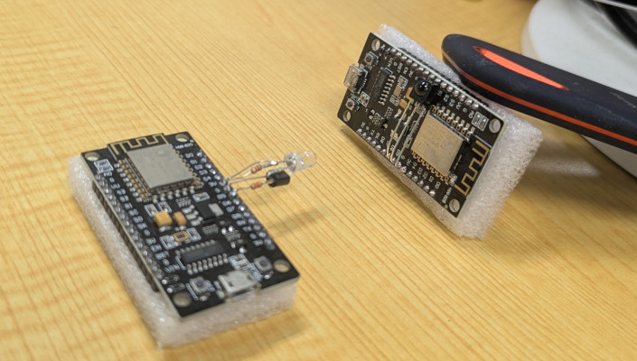

# IR Remote Web Server for ESP8266

This project turns a NodeMCU ESP8266 into a Wi-Fi-controlled infrared remote. It exposes an authenticated HTTP API for browsers, `curl`, Home Assistant, and other automation systems.

It currently supports Corona air conditioners, NEC-protocol light commands, and a separate IR receiver sketch for discovering remote-control signals. Starting state can also be bootstraped through the API.

The firmware is intended for a local, trusted network. It uses HTTP Basic Authentication, not HTTPS, and the AC state is kept in RAM, so it returns to its configured defaults after a reboot.

## Hardware

The source targets a NodeMCU ESP8266:

| Function            | Pin           | Notes                                   |
| ------------------- | ------------- | --------------------------------------- |
| Built-in status LED | `D4`          | Active-low on typical NodeMCU boards    |
| IR output           | `D5` / GPIO14 | Used by both Corona AC and NEC commands |
| IR receiver         | `D5`          | Used by the standalone decoder sketch   |

Do not drive a high-current IR LED directly from an ESP8266 GPIO. Use a suitable resistor and transistor/MOSFET driver or an IR transmitter module. Confirm pin labels for your board before wiring it.



## Project layout

- `src/irremote_webserver.cpp` — Wi-Fi, HTTP routes, authentication, state initialization, and IR commands.
- `lib/CoronaAC/` — Corona AC state model and IR command wrapper.
- `ir_decoder_sketch/ir_decorder_sketch.ino` — Arduino IDE sketch for capturing IR signals.
- `platformio.ini` — board, framework, libraries, and upload settings.
- `src/secrets.h` — local Wi-Fi and Basic Auth credentials, do not upload it to your repositories.

## Requirements

- NodeMCU ESP8266 board and IR transmitter circuit
- An AC remote or receiver if decoding a protocol
- [Optional] PlatformIO IDE for VSCode

Libraries are declared in `platformio.ini`: `IRremoteESP8266`, `ArduinoJson`, and `IRremote`.

## Configuration

Create or edit `src/secrets.h` (ignored by Git) with your own values:

```cpp
#ifndef SECRETS_H
#define SECRETS_H

#define AP_SSID "your-wifi-name"
#define AP_PASS "your-wifi-password"
#define BAUTH_USER "your-api-user"
#define BAUTH_PASS "a-long-random-password"

#endif
```

Do not commit real Wi-Fi or API credentials. The initial AC defaults are near the top of `src/irremote_webserver.cpp`: 18 °C, Heat, Auto fan, swing off, and Econo on. Change them if required; the supported temperature range is enforced by the Corona protocol library.

## Build and upload

From the project directory:

```bash
pio run
pio run --target upload
pio device monitor
```

The serial monitor runs at `115200` baud. After connecting to Wi-Fi, the firmware prints its IP address. Open it in a browser and authenticate to verify the installation.

The `upload_port` in `platformio.ini` is machine-specific. Replace it with your serial device or remove it for autodetection. After the first USB upload, OTA can be configured, for example:

```ini
upload_protocol = espota
upload_port = irremote-webserver.local
```

The firmware already calls `ArduinoOTA.handle()` in `loop()`.

## HTTP API

Every route requires HTTP Basic Authentication. Replace `DEVICE_IP`, `USER`, and `PASSWORD` below.

```bash
curl --user USER:PASSWORD http://DEVICE_IP/
curl --user USER:PASSWORD http://DEVICE_IP/turnACOn
curl --user USER:PASSWORD http://DEVICE_IP/setTemp/22
```

The root route returns `Login OK` after successful authentication.

### Corona AC routes

| Route                    | Behavior                                               |
| ------------------------ | ------------------------------------------------------ |
| `/turnACOn`              | Sends the power-on command                             |
| `/turnACOff`             | Sends the power-off command                            |
| `/increaseTemp`          | Increases tracked temperature by 1 °C                  |
| `/reduceTemp`            | Decreases tracked temperature by 1 °C                  |
| `/setTemp/{temperature}` | Sets a numeric temperature, clamped to protocol limits |
| `/toggleSwing`           | Toggles vertical swing                                 |
| `/rotateFanMode`         | Cycles Auto → Low → Mid → High → Auto                  |
| `/setFanMode/{mode}`     | Sets `Auto`, `Low`, `Mid`, or `High`                   |
| `/rotateACMode`          | Cycles Heat → Dry → Cool → Fan → Heat                  |
| `/setACMode/{mode}`      | Sets `Heat`, `Dry`, `Cool`, or `Fan`                   |

Examples:

```bash
curl --user USER:PASSWORD http://DEVICE_IP/setACMode/Cool
curl --user USER:PASSWORD http://DEVICE_IP/setFanMode/Auto
curl --user USER:PASSWORD http://DEVICE_IP/toggleSwing
```

Responses are plain text descriptions of the command sent. The device does not query the physical AC for confirmation; it tracks its own in-memory state.

### NEC light routes

| Route             | Behavior            |
| ----------------- | ------------------- |
| `/turnLightsOn`   | Full lights on      |
| `/turnLightsOff`  | Lights off          |
| `/increaseLights` | Increase brightness |
| `/reduceLights`   | Decrease brightness |

To adapt these commands to another NEC remote, use the decoder sketch and update `kIRConAddress` and the command constants in `src/irremote_webserver.cpp`.

## Home Assistant

The API can be used with `rest_command`:

```yaml
rest_command:
  ac_cool:
    url: "http://192.168.1.50/setACMode/Cool"
    username: "your-api-user"
    password: "your-api-password"
  ac_temperature:
    url: "http://192.168.1.50/setTemp/{{ temperature }}"
    username: "your-api-user"
    password: "your-api-password"
  lights_off:
    url: "http://192.168.1.50/turnLightsOff"
    username: "your-api-user"
    password: "your-api-password"
```

Call one from an automation or script:

```yaml
action:
  - action: rest_command.ac_temperature
    data:
      temperature: 24
```

Because there is no status endpoint, Home Assistant should maintain displayed state separately or treat calls as actions. A DHCP reservation is recommended so the device address remains stable.

## Decoding a different remote

1. Open `ir_decoder_sketch/ir_decorder_sketch.ino` in Arduino IDE.
2. Connect an IR receiver module to `D5`, power, and ground.
3. Upload it and open the serial monitor at `115200` baud.
4. Press remote buttons and record protocol, address, command, and raw timing output.
5. Translate the values into a handler or protocol wrapper.

The sketch currently enables NEC decoding and prints short and formatted raw results. Enable the appropriate decoder for a non-NEC remote and verify its output before adding it to the web server. The receiver and transmitter should not be used on the same pin at the same time.

## Extending the project

To add a command, define an authenticated handler in `src/irremote_webserver.cpp`, send the IR frame, and register a route in `setup()`. Keep protocol-specific state and behavior in a library under `lib/` when it grows beyond a few commands.

Useful extensions include a `/status` JSON route, MQTT integration, persistent state in EEPROM/LittleFS, a web UI, or a VPN/reverse proxy for remote access.

## Troubleshooting

- **No Wi-Fi:** verify `src/secrets.h`, the 2.4 GHz network, and the serial log. The firmware restarts after a failed connection.
- **401 Unauthorized:** check the Basic Auth credentials and that the client sends them.
- **AC does not respond:** check IR LED polarity, driver wiring, line of sight, GPIO selection, and Corona compatibility.
- **State is wrong after restart:** expected; state comes from compile-time defaults.
- **Upload fails:** check the serial port, bootloader mode, and that no other monitor has the port open.

## Security

Basic Auth encodes credentials but does not encrypt them. Keep this device on a trusted LAN, use a strong password, and do not expose it directly to the internet. The API has no rate limiting.
